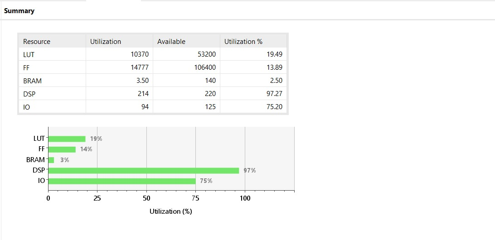
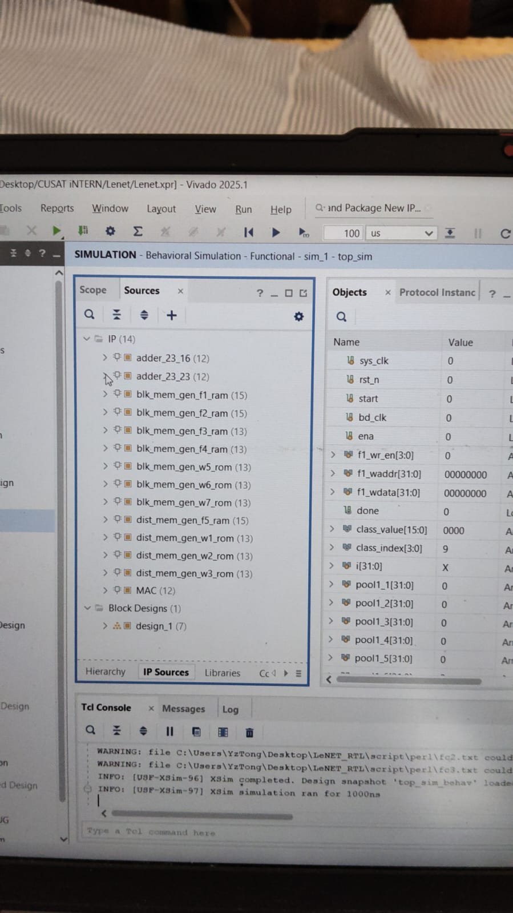

# Pipelined Binary-Weight LeNet-5 Accelerator on PYNQ-Z2 (XNOR-Popcount)

A Verilog RTL accelerator for the LeNet-5 convolutional neural network, which recognizes handwritten MNIST digits. Every layer is built as a hardware stage. A chain of `start`/`done` signals runs an image through `conv1 → pool1 → conv2 → pool2 → fc1 → fc2 → fc3 → argmax`. The accelerator returns the predicted digit (`class_index`) and its score (`class_value`).

The target board is the **PYNQ-Z2**, which uses the Xilinx Zynq-7000 XC7Z020. The project is built with **Vivado 2025.1**.

> **Project status:** In the RTL committed today, every layer runs on DSP48 multiply-accumulate (MAC) units. These multiply 16-bit activations by 8-bit weights. The XNOR-popcount datapath for binary weights in the project title is the planned next step. It isn't in this code yet. See [Roadmap](#roadmap).

---

## Results

### Post-synthesis resource utilization (XC7Z020)



| Resource | Used   | Available | Utilization |
|----------|-------:|----------:|------------:|
| LUT      | 10,370 | 53,200    | 19.49 %     |
| FF       | 14,777 | 106,400   | 13.89 %     |
| BRAM     | 3.5    | 140       | 2.50 %      |
| DSP      | 214    | 220       | **97.27 %** |
| IO       | 94     | 125       | 75.20 %     |

The design uses 214 of the chip's 220 DSP slices, so DSPs are what limit it. That is why the plan is to replace the multipliers with XNOR-popcount logic. With binary weights, each multiply becomes an XNOR gate plus a bit count, which runs in LUTs, and the chip has about 80 % of its LUTs free. The IO count is high because the top-level ports of `CNN_accelerator` are routed straight to package pins. Once the core sits behind an AXI interface to the Zynq processing system, that count should drop.

### Behavioral simulation (Vivado XSim)



The photo shows a behavioral simulation of `top_sim` in Vivado 2025.1. On the left, the IP Sources pane lists the 14 IPs the design uses (the MAC, adders, block-RAM and distributed-RAM IPs). On the right, the Objects pane shows the accelerator's ports and the testbench's per-layer dump handles. The run in the photo is the default 1000 ns. The testbench holds reset until 1200 ns, so nothing has been computed yet: `done` is still 0. To see a classification, run the simulation longer (see [Simulating](#simulating)).

---

## Architecture

```
 f1_wdata / f1_waddr / f1_wr_en        (bd_clk)
                │
                ▼
   f1_ram   1 × 32 × 32, 8-bit         (everything below runs on sys_clk)
                │
                ▼
   conv1    6 × 28 × 28  ◄──┐
   pool1    6 × 14 × 14     │
   conv2   16 × 10 × 10  ◄──┤
   pool2   16 × 5 × 5       ├── shared_mac_bank (214 × DSP48 MAC)
   fc1    120            ◄──┤
   fc2     84            ◄──┤
   fc3     10            ◄──┘
                │
                ▼
   argmax ──► class_index[3:0], class_value[15:0], done
```

| Stage  | Output         | MAC units                    | Weight ROM                      | Feature-map RAM written |
|--------|----------------|------------------------------|---------------------------------|-------------------------|
| input  | 1 × 32 × 32    | –                            | –                               | `f1_ram` (8-bit pixels) |
| conv1  | 6 × 28 × 28    | 6 (shared, DSP 96–101)       | `w1_rom` (6 × 8-bit per read)   | `f2_ram`                |
| pool1  | 6 × 14 × 14    | –                            | –                               | `f3_ram`                |
| conv2  | 16 × 10 × 10   | 96 (shared, DSP 0–95)        | `w3_rom` (96 × 8-bit per read)  | `f4_ram`                |
| pool2  | 16 × 5 × 5     | –                            | –                               | `f5_ram`                |
| fc1    | 120            | 120 (DSP 0–119)              | `w5_rom` (120 × 8-bit per read) | `f6`                    |
| fc2    | 84             | 84 (DSP 120–203)             | `w6_rom` (84 × 8-bit per read)  | `f7`                    |
| fc3    | 10             | 10 (DSP 204–213)             | `w7_rom` (10 × 8-bit per read)  | `class0` … `class9`     |
| argmax | digit 0–9      | –                            | –                               | `class_index`, `class_value` |

How it works:

- **One shared MAC bank.** `shared_mac_bank` creates 214 `MAC` instances. Each one is a Xilinx `mult_gen` that multiplies a 16-bit value by an 8-bit value. A `sel` register decides whether DSPs 0–101 serve conv1/conv2 or fc1. It is set when conv1 starts and cleared when fc1 starts. Sharing these DSPs is what lets the network fit in 220 DSPs.
- **Parallel channels.** In conv2, all 16 × 6 output/input channel pairs are computed in the same cycle. In each fully connected layer, every output neuron gets its own MAC. Activations are read from RAM once and broadcast to all MACs that need them.
- **A controller and a datapath per layer.** Each layer has a `*_ctrl` module, which generates addresses, write enables and `clr` (accumulator clear) signals. It also has a `*_exec` module, which handles bias, adder trees, ReLU and pooling. Each layer's `done` signal is wired to the next layer's `start`.
- **Two clocks.** `bd_clk` writes the input image into `f1_ram` through a 32-bit port with byte enables. All computation runs on `sys_clk`. The testbench drives `sys_clk` at 50 MHz.
- **Fixed-point numbers.** Pixels are 8 bits, activations are 16 bits and weights are 8 bits. The adders (`c_addsub`) are 23 bits wide.

### Top-level ports (`CNN_accelerator`)

| Port          | Dir | Width | Description |
|---------------|-----|-------|-------------|
| `sys_clk`     | in  | 1     | Compute clock |
| `bd_clk`      | in  | 1     | Write clock for the input-image RAM |
| `rst_n`       | in  | 1     | Active-low asynchronous reset |
| `start`       | in  | 1     | Pulse to start inference on the image in `f1_ram` |
| `ena`         | in  | 1     | Enable for the `f1_ram` write port |
| `f1_wr_en`    | in  | 4     | Byte write enables for `f1_ram` |
| `f1_waddr`    | in  | 32    | Write address for `f1_ram` |
| `f1_wdata`    | in  | 32    | Write data (pixels) for `f1_ram` |
| `done`        | out | 1     | High when the argmax result is valid |
| `class_index` | out | 4     | Predicted digit (0–9) |
| `class_value` | out | 16    | Score of the winning class |

---

## Repository layout

```
Lenet.srcs/
├── sources_1/
│   ├── new/
│   │   ├── CNN_accelerator.v     # top level: memories, layer controllers/executors, start/done chain
│   │   ├── shared_mac_bank.v     # 214 DSP MACs and the conv/fc input multiplexing
│   │   └── design_1_wrapper.v    # Zynq PS block-design wrapper (DDR / FIXED_IO)
│   ├── ip/                       # Vivado IP configurations (.xci)
│   │   ├── MAC/                  # mult_gen 16×8
│   │   ├── adder_23_16/, adder_23_23/            # c_addsub
│   │   ├── blk_mem_gen_f{1..4}_ram/              # feature-map block RAMs
│   │   ├── blk_mem_gen_w{5,6,7}_rom/             # fc weight ROMs
│   │   ├── dist_mem_gen_f5_ram/                  # pool2 output (distributed RAM)
│   │   └── dist_mem_gen_w{1,2,3}_rom/            # conv weight ROMs (distributed RAM)
│   ├── bd/design_1/              # block design
│   └── utils_1/imports/synth_1/CNN_accelerator.dcp   # synthesis checkpoint
└── sim_1/new/top_sim.v           # testbench: reset, start pulse, per-layer dumps to text files
docs/images/                      # README images
```

---

## Building and simulating

### What you need

- Vivado 2025.1 (WebPACK is enough for the XC7Z020).
- The PYNQ-Z2 board files, installed in Vivado, if you want to target the board directly.

### Setting up the project

This repository holds only `Lenet.srcs/`. The `.xpr` project file and the generated `.gen/`, `.runs/` and `.sim/` folders aren't committed. To rebuild the project:

1. In Vivado, create a new RTL project for the PYNQ-Z2 board or the `xc7z020clg400-1` part.
2. Add the files in `Lenet.srcs/sources_1/new/` as design sources and `Lenet.srcs/sim_1/new/top_sim.v` as a simulation source.
3. Add the `.xci` files in `Lenet.srcs/sources_1/ip/`. When Vivado offers to upgrade or regenerate the IPs, accept.
4. Set `CNN_accelerator` as the synthesis top and `top_sim` as the simulation top.

> The committed `.xci` files and `design_1.bd` are tagged with the part `xc7s50csga324-1` (Spartan-7). The utilization report above is for the XC7Z020. When you change the project part, Vivado retargets the IPs. The committed `design_1.bd` is also an empty placeholder: it has no Zynq PS instance yet.

### Simulating

1. Point the `$fopen` paths in `top_sim.v` at a folder on your machine. They are currently hard-coded to `C:\Users\YzTong\Desktop\LeNET_RTL\script\perl\`. Those paths cause the `file ... could not be opened` warnings in the photo.
2. Run **Run Simulation → Run Behavioral Simulation**.
3. The default run length is 1000 ns, but reset is held until 1200 ns. Run longer, with `run all` or a run time of at least `100 us`, until `done` goes high. Then read `class_index` and `class_value`.

As the testbench runs, it writes each layer's outputs to text files (`pool11.txt` … `pool216.txt`, `fc1.txt`, `fc2.txt`, `fc3.txt`). You can compare these against a software model of the network.

---

## Known gaps

- **Missing sources.** `CNN_accelerator.v` instantiates modules whose sources aren't in this repository yet: `f1_ram` … `f5_ram`, `w1_rom` … `w7_rom`, `conv1_ctrl`/`conv1_exec`, `pool1_ctrl`/`pool1_exec`, `conv2_ctrl`/`conv2_exec`, `pool2_ctrl`/`pool2_exec`, `fc{1,2,3}_ctrl`/`fc{1,2,3}_exec` and `get_class`. Until they're added, a fresh clone won't elaborate.
- **No weights or test images.** No `.coe` initialization files are committed, and all memory IPs show `no_coe_file_loaded`. There is also no script that trains the network or exports weights.
- **No PS integration yet.** `design_1_wrapper.v` exposes only the Zynq DDR and FIXED_IO pins. The accelerator isn't connected to the processing system over AXI, and there is no PYNQ overlay or Python driver.

## Roadmap

1. Commit the missing layer, controller and memory modules, plus the weight `.coe` files, so the project builds from a clean clone.
2. **Binary weights with XNOR-popcount.** Binarize the weights to ±1 and replace the DSP MACs with XNOR gates and popcount adder trees running in LUTs. This would free most of the 214 DSPs.
3. Pipeline across layers, so a new image can enter conv1 while the previous one is still in the fc layers.
4. Wrap the core in AXI4-Lite (control) and AXI BRAM or DMA (image input). Then generate a bitstream and PYNQ overlay, and drive it from a Jupyter notebook on the PYNQ-Z2.
5. Report MNIST accuracy, latency and throughput measured on the board.

---

## Credits

The RTL in `Lenet.srcs/` is based on a LeNet-5 RTL design by **YzTong (UESTC, 2018)**, as the file headers credit. It has been ported to Vivado 2025.1 for this project.

## License

[MIT](LICENSE) © 2026 Bharath Krishna
